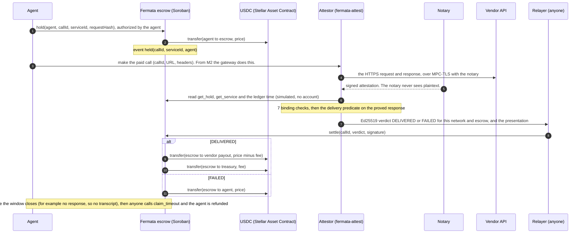

# Fermata on Stellar: pay on proof

[](https://github.com/bilgin-kocak/fermata-stellar/actions/workflows/ci.yml)

**Chargebacks for machine payments, decided on cryptographic evidence instead of a support ticket.**

A card payment has a chargeback: when the goods never arrive, the buyer disputes and a person reads
the ticket. An agent paying an API per call has nothing. It pays, the API answers with a 500 or
with malformed JSON, and the money is gone.

Fermata is the chargeback for that payment, except no one reads a ticket:

- the payment is **held** in escrow;
- the vendor's HTTPS response is recorded with [TLSNotary](https://github.com/tlsnotary/tlsn);
- the hold is **released** to the vendor only when that record passes a pre-agreed, mechanically
  checkable delivery predicate;
- a verified failure, or a proof window that runs out, **refunds** the agent.

This repository makes Stellar Fermata's primary home. It ports
[Fermata on Tempo](https://github.com/bilgin-kocak/fermata), a working system there, in milestones
([`ROADMAP.md`](ROADMAP.md)):

- **Milestone 0: the escrow.** A Soroban contract holds an agent's USDC for one call. The
  service's registered verifier signs an Ed25519 verdict that Stellar verifies natively. DELIVERED
  pays the vendor the price minus a 0.5 % fee; FAILED refunds the agent. With no verdict before the
  settlement window closes, anyone can trigger the refund.
- **Milestone 1: the proof.** The attestor (`fermata-attest`, TLSNotary `v0.1.0-alpha.15`) makes
  the paid call over MPC-TLS through a notary, checks the presentation against the hold and the
  service it reads from the escrow, evaluates the delivery predicate, and only then signs the
  verdict. Anyone can re-verify the presentation offline against the hashes on chain.

**In this milestone the notary is run by the same operator as the attestor** (the scripts start
one with a key made for the run). An independent notary is the first trust-minimization step on
the roadmap.

Vocabulary throughout: `hold → release(proof) → refund`.

## How it works on Stellar



How the parts map from Tempo:

- **Payment pull.** The agent authorizes `hold`, and that authorization covers the token transfer
  with its exact amount. This replaces Tempo's TIP-20 permit.
- **Linking money to a call.** The escrow's events carry the call id as a topic, next to the
  token's transfer events in the same transaction. This replaces Tempo's transfer memos.
- **The verdict.** It is signed over
  `"FERMATA_STELLAR_VERDICT_V1" ‖ sha256(network passphrase) ‖ escrow id ‖ the verdict's eight
  fields` and checked with the host's `ed25519_verify`. A verdict for another call, network or
  escrow does not settle.
- **The attestor's reads.** It reads the hold and the service by simulating the escrow's views
  over Soroban RPC from an account that does not exist, so it needs no Stellar account; chain time
  is the latest ledger's close time.
- **Every difference** from the Solidity contract, with its reason, is in
  [`docs/PORTING_NOTES.md`](docs/PORTING_NOTES.md).

## Status

| Capability | Status |
|---|---|
| Escrow: `register_service`, `hold`, `settle`, `claim_timeout`, fee and treasury administration, events | **Implemented and tested on Stellar** ([`contracts/escrow`](contracts/escrow), 62 tests) |
| Stellar verdict: encoding, Ed25519 signer, strict verification, CLI, golden vectors | **Implemented and tested on Stellar** ([`crates/fermata-verdict`](crates/fermata-verdict), 28 tests; [`test-vectors/`](test-vectors)) |
| TLSNotary attestor: proving, notary, 7 binding checks, predicates, HTTP API, offline re-verification | **Implemented and tested on Stellar** ([`apps/attestor`](apps/attestor): 14 unit tests and an integration test with real MPC-TLS sessions; its verdicts settle on the escrow in the contract tests) |
| TypeScript SDK: typed escrow client, verdict encoding and signatures, registration hashes | **Implemented and tested on Stellar** ([`packages/sdk`](packages/sdk), 19 tests, plus a live parity test against a deployment) |
| Deployment and the three canonical cases (`scripts/`) | **Implemented and tested on Stellar**: `demo-cases.sh` (script-signed verdicts, M0) and `attest-cases.sh` (real TLSNotary proofs, M1) each pass 3/3 on a local network (protocol 29), in CI too. The testnet run is pending; see [Live on testnet](#live-on-testnet). |
| Gateway with the `fermata` MPP payment method, MCP server (`fermata-mcp`) | **Only in the Tempo version**. On Stellar: MPP and x402 planned in M2. |
| Dashboard, reconciliation, vendor scores, self-serve onboarding | **Only in the Tempo version**. Planned in M2 (onboarding in M3). |
| Session escrow, sampled proving | **Planned** (M2), in neither version yet |
| Mainnet, security audit, design partners | **Planned** (M3) |
| Independent notary, vendor-chosen verifiers, N-of-M quorum, on-chain presentation verification | **Planned** (trust minimization) |

## Live on testnet

**Not deployed yet.** The build environment that produced these milestones cannot reach Stellar
testnet: its network policy refuses the RPC, Horizon and Friendbot hosts. So nothing here claims a
testnet deployment, and [`deployments/testnet.json`](deployments/testnet.json) is a placeholder.
All three scripts ran against a local Stellar network (stellar-core 29.0.0, RPC 29.0.1, protocol 29,
testnet resource limits) instead, and the CI runs them there on every push.

To deploy and run the cases on testnet, from a machine that reaches it:

```sh
git clone https://github.com/bilgin-kocak/fermata-stellar && cd fermata-stellar
scripts/deploy-testnet.sh   # builds, creates fermata-* identities, deploys, registers the demo service,
                            # writes deployments/testnet.json and prints the agent's address
# Circle's testnet USDC: request it for that address at https://faucet.circle.com (Stellar testnet);
# the cases below use 7 calls at 0.01 USDC. The faucet is a web form with a captcha. Or skip it with
# a self-issued test asset:
#   TOKEN=test scripts/deploy-testnet.sh
scripts/demo-cases.sh       # M0: release, verified-failure refund, timeout refund (script-signed verdicts)
scripts/attest-cases.sh     # M1: the same three cases with real TLSNotary proofs, offline re-verification
                            # and a replay check; needs Node, and builds the attestor (a few minutes)
```

This section then lists the contract id and the transaction links: a hold and a settlement or
claim for each case. The vendors, the notary and the attestor run on the machine that runs
`attest-cases.sh`; only the escrow is on testnet. Testnet is reset about once a quarter; the
scripts redeploy from scratch.

## Quick start

Requirements:

- Rust via rustup: `rust-toolchain.toml` pins 1.97.0 with the `wasm32v1-none` target, and
  `apps/attestor/rust-toolchain.toml` pins 1.95.0, which TLSNotary needs.
- The Stellar CLI, 25.2 or newer (tested with 28.1.0); `soroban-sdk` 29 builds contracts only
  through `stellar contract build`.
- Node 22.12 or newer, with pnpm through corepack (`corepack enable`), for the SDK and the demo
  vendor.
- `jq`, `openssl` and `curl` for the scripts.
- Python 3 with `cryptography` for the independent vector check.

```sh
rustup toolchain install                          # the pinned toolchain
cargo test --workspace                            # 90 tests, about 15 s once built
cargo clippy --all-targets -- -D warnings && cargo fmt --all -- --check
stellar contract build --package fermata-escrow   # target/wasm32v1-none/release/fermata_escrow.wasm
python3 test-vectors/check_vectors.py             # golden vectors, independently (pip install cryptography)

cd apps/attestor                                  # Rust 1.95.0 (rustup installs it from rust-toolchain.toml)
cargo test --release                              # unit tests; the first build takes a few minutes
cargo test --release --test attest -- --ignored --nocapture   # real MPC-TLS sessions (node, openssl)
cd ../..

pnpm install && pnpm sdk:typecheck && pnpm sdk:test
```

Against a local Stellar network (Docker):

```sh
docker run -d --name stellar --network host stellar/quickstart:latest \
  --local --enable core,rpc,horizon --protocol-version 29   # the image defaults to protocol 28
NETWORK=local scripts/deploy-testnet.sh           # uses a self-issued FERMATATEST asset
NETWORK=local scripts/demo-cases.sh
NETWORK=local scripts/attest-cases.sh
FERMATA_DEPLOYMENT=deployments/local.json pnpm sdk:test   # also checks the deployment's views
```

That `docker run` command is the one these scripts were tested with (on Linux). Where host
networking is unavailable, map the port instead (`-p 8000:8000`).
`stellar container start local --protocol-version 29` should start the same network; it was not
tested here.

Keys live only in the Stellar CLI keystore (`stellar keys`). [`.env.example`](.env.example) lists
the settings the scripts read.

Prove, verify and sign by hand: `fermata-attest --help` (`notary`, `prove`, `verify [--offline]`,
`serve`, `hashes`). Sign and check a verdict without a proof:

```sh
cargo run -q -p fermata-verdict -- --help
FERMATA_VERIFIER_SECRET="$(stellar keys secret fermata-verifier)" \
  cargo run -q -p fermata-verdict -- sign --network-passphrase "Test SDF Network ; September 2015" \
  --contract C... --call-id ... --service-id ... --request-hash ... --predicate-hash ... \
  --outcome delivered --presentation-hash ... --response-hash ...
```

## Trust model

- **What the contract enforces.** The escrow trusts one Ed25519 verifier key per service, and
  enforces everything around that key:
  - only the agent can fund a hold, for exactly the service's price;
  - only the pinned key can settle, for the call, service, request, predicate, network and
    contract it signed, inside the window;
  - after the window, anyone can refund the agent;
  - the owner can change the fee (at most 5 %, never for open holds) and the treasury, never
    held funds;
  - services are immutable and there is no upgrade path.
- **What it cannot check** is whether a verdict is true. The attestor signs only after verifying
  a TLSNotary presentation that anyone can re-verify offline (`fermata-attest verify --offline`,
  against the hashes the escrow stores). A dishonest verdict is therefore detectable, though not
  prevented. In this milestone the notary and the attestor have the same operator, so a dishonest
  operator could also forge a transcript; an independent notary removes that.
- **Closing that gap.** Vendor-chosen verifiers, an N-of-M quorum and on-chain verification are on
  the roadmap. Details: [`docs/trust-model.md`](docs/trust-model.md) and
  [`docs/security.md`](docs/security.md).

## What the proof does and does not establish

Ported from Fermata. The attestor here is Fermata's, so the same limits apply.

- **What a presentation proves.** A TLSNotary presentation establishes that a specific HTTPS
  server, identified by its TLS certificate, sent specific bytes in response to specific request
  bytes. That is all.
  - It does not establish that the data is correct: a quoted price can be wrong.
  - It cannot establish that a server never responded: no transcript, no proof.
- **What the predicate can check.** The delivery predicate contains only what can be checked on
  the transcript: status code, content type, body size, JSON shape.
  - There are no latency or timing checks, because the transcript has no trusted clock.
  - Latency SLAs, if any, are gateway policy, not proof-backed.
- **No response, no verdict.** No response from the vendor means no transcript, which means no
  verdict. The agent is protected by the on-chain timeout refund, never by a verdict signed
  without evidence.
- **Privacy.** A presentation reveals the vendor's whole response.
  - Fermata's Tempo demo serves every presentation publicly so that anyone can re-verify. That is
    fine for test data, not for proprietary or personal data.
  - Production needs proofs shared only with the agent, the vendor and, in a dispute, an auditor,
    plus selective disclosure.

## The verdict and its vectors

A verdict has the same eight fields as Fermata's EIP-712 `Verdict`: call id, service id, request
hash, predicate hash, outcome, presentation hash, response hash and issue time. It is signed over
a 294-byte message in which every field is fixed-width and integers are big-endian (layout in
[`docs/architecture.md`](docs/architecture.md#the-verdict)).

The network id (sha256 of the network passphrase) and the escrow's contract id take the place of
EIP-712's `chainId` and `verifyingContract`.

[`test-vectors/verdict-v1.json`](test-vectors/verdict-v1.json) pins the encoding, and three
implementations agree on it byte for byte:

- **The contract.** It rebuilds each message and settles holds with the recorded signatures.
- **`fermata-verdict`.** It re-encodes the messages and reproduces the signatures, since Ed25519 is
  deterministic.
- **[`check_vectors.py`](test-vectors/check_vectors.py).** It is written in Python and signs with
  OpenSSL.
- **The TypeScript SDK** reproduces every message and signature too.

[`test-vectors/attest-v1.json`](test-vectors/attest-v1.json) holds two verdicts the attestor
signed for real TLSNotary presentations of the demo vendor: a 200 quote (DELIVERED) and an
authenticated 500 (FAILED). The attestor's integration test writes it; the contract settles both
verdicts, and the SDK and the Python check verify them.

## Repository layout

```
contracts/escrow/          Soroban port of FermataEscrow (src/tests: the ported suite and more)
crates/fermata-verdict/    Stellar verdict encoding + Ed25519 signer: library and CLI
apps/attestor/             fermata-attest: TLSNotary prover, notary and verifier, signing for Stellar
                           (its own workspace, Rust 1.95.0)
apps/vendor/               the demo vendor from Fermata: a TLS 1.2 quote API with failure modes
packages/sdk/              the TypeScript SDK: generated escrow client, verdict, hashes
test-vectors/              golden vectors and the attestor's real verdicts, asserted by the
                           contract, the crates and the SDK, plus an independent Python/OpenSSL check
scripts/                   deploy-testnet.sh, demo-cases.sh, attest-cases.sh (and lib.sh)
predicates/                the demo service's delivery predicate (from Fermata)
deployments/testnet.json   the testnet deployment (a placeholder until the script runs there)
docs/                      PORTING_NOTES.md, architecture.md, trust-model.md, security.md
```

## Prior work

- **[Fermata on Tempo](https://github.com/bilgin-kocak/fermata).** The system this repository
  ports: a Solidity escrow, the `fermata-attest` attestor (TLSNotary `v0.1.0-alpha.15`), an MPP
  gateway, a TypeScript SDK, a dashboard, an MCP server and a demo vendor with failure modes.
  Fermata's own documentation reports these numbers, **measured on Tempo, not on Stellar**:
  - **Tempo's Moderato testnet**, 2026-10-01: the three canonical cases passed 3/3, and a 100-call
    run against a vendor failing at random gave 96 releases and 4 refunds, with MPC-TLS proving
    at 1.03 s per call (median).
  - **Anvil's Tempo emulation**: about 66 MB of prover-to-notary traffic per proof.

  None of these have been measured on Stellar testnet yet. The proving side does not depend on the
  chain: in this repository's integration test (4 vCPUs, the local demo vendor), a proof took 1.1
  to 2.2 s, with about 62 MB sent and 3.9 MB received between prover and notary, and a few sessions
  needed a second attempt after an MPC setup stall, which the retry handles.
- **[WebProof](https://github.com/bilgin-kocak/webproof-solana).** The earlier bridge from
  TLSNotary to signed claims, on Solana. Fermata's attestor ports its TLSNotary code, and this
  repository reuses its claim pattern: a versioned tag, canonical bytes, Ed25519, and a vector
  file in the repository.
- **[SorobanGenie](https://github.com/bilgin-kocak/soroban-genie).** Earlier Stellar work: a chat
  assistant that turns plain-language requests into Soroban contracts.

## License and security

Apache-2.0 ([`LICENSE`](LICENSE)). [`NOTICE`](NOTICE) lists the code and text ported from Fermata
(MIT) and WebProof (Apache-2.0). The code is unaudited and for testnet only; see
[`docs/security.md`](docs/security.md) for the scope, the known limitations and how to report a
vulnerability.
