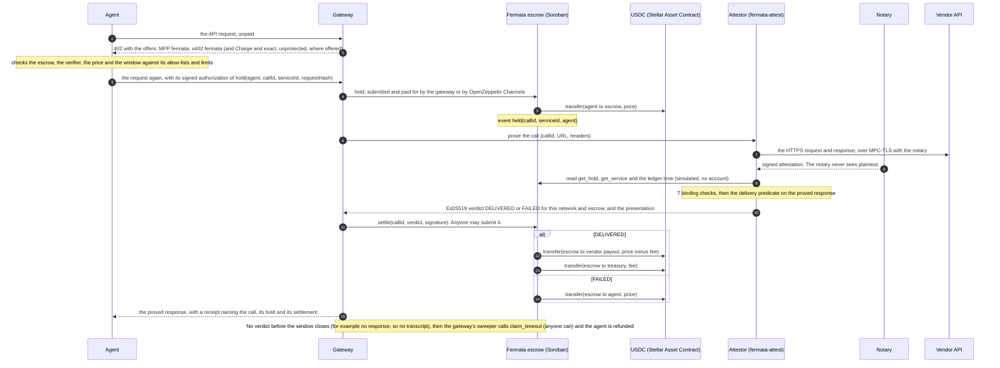

# Fermata on Stellar: pay on proof

[](https://github.com/bilgin-kocak/fermata-stellar/actions/workflows/ci.yml)

**Chargebacks for machine payments, decided on cryptographic evidence instead of a support ticket.**

A card payment has a chargeback: when the goods never arrive, the buyer disputes and a person reads
the ticket. An agent paying an API per call has nothing. It pays, the API answers with a 500 or
with malformed JSON, and the money is gone.

Fermata is the chargeback for that payment, except no one reads a ticket:

- the payment is **held** in escrow;
- the vendor's HTTPS response is recorded with [TLSNotary](https://github.com/tlsnotary/tlsn);
- the hold is **released** to the vendor only when that record passes a pre-agreed, mechanically
  checkable delivery predicate;
- a verified failure, or a proof window that runs out, **refunds** the agent.

This repository makes Stellar Fermata's primary home. It ports
[Fermata on Tempo](https://github.com/bilgin-kocak/fermata), a working system there, in milestones
([`ROADMAP.md`](ROADMAP.md)):

- **Milestone 0: the escrow.** A Soroban contract holds an agent's USDC for one call. The
  service's registered verifier signs an Ed25519 verdict that Stellar verifies natively. DELIVERED
  pays the vendor the price minus a 0.5 % fee; FAILED refunds the agent. With no verdict before the
  settlement window closes, anyone can trigger the refund.
- **Milestone 1: the proof.** The attestor (`fermata-attest`, TLSNotary `v0.1.0-alpha.15`) makes
  the paid call over MPC-TLS through a notary, checks the presentation against the hold and the
  service it reads from the escrow, evaluates the delivery predicate, and only then signs the
  verdict. Anyone can re-verify the presentation offline against the hashes on chain.
- **Milestone 2: the gateway.** An agent pays for an API call through the gateway
  (`apps/gateway`), with the `fermata` payment method for MPP or the `fermata` scheme for x402.
  - **Either way the agent signs only the authorization of `hold`.** The gateway submits the hold
    and pays its fee.
  - **The gateway then does the rest.** It has the attestor prove the vendor's response, settles
    the verdict, and refunds holds that got no verdict with `claim_timeout`.
  - **Unprotected options.** Stellar's MPP Charge and x402 `exact` are offered next to them and
    pay the vendor directly, with no escrow and no proof.
  - **Reconciliation.** An indexer keeps the escrow's and the token's events, and every call
    reconciles from them. A dashboard shows the calls.
- **Milestone 2: sessions, phase 1.** An agent deposits once in a session contract for up to N
  calls of a service, and each call costs a signed ticket instead of a transaction
  ([`docs/session-escrow.md`](docs/session-escrow.md)).
  - Every call is still proved.
  - The attestor signs a statement over each batch of results, and the gateway settles the
    batches and closes the session after its deadline.
  - Sampled proving, which would prove only some of the calls, is phase 2 and not built.

**In these milestones the notary is run by the same operator as the attestor** (the scripts start
one with a key made for the run). An independent notary is the first trust-minimization step on
the roadmap.

Vocabulary throughout: `hold → release(proof) → refund`.

## How it works on Stellar



How the parts map from Tempo:

- **Payment pull.** The agent authorizes `hold`, and that authorization covers the token transfer
  with its exact amount. This replaces Tempo's TIP-20 permit.
- **Linking money to a call.** The escrow's events carry the call id as a topic, next to the
  token's transfer events in the same transaction. This replaces Tempo's transfer memos.
- **The verdict.** It is signed over
  `"FERMATA_STELLAR_VERDICT_V1" ‖ sha256(network passphrase) ‖ escrow id ‖ the verdict's eight
  fields` and checked with the host's `ed25519_verify`. A verdict for another call, network or
  escrow does not settle.
- **The attestor's reads.** It reads the hold and the service by simulating the escrow's views
  over Soroban RPC from an account that does not exist, so it needs no Stellar account; chain time
  is the latest ledger's close time.
- **Paying through the gateway.** There are two escrowed ways to pay:
  - **MPP.** Fermata's `fermata` method is ported to mppx 0.10.1. The agent either signs only the
    authorization of `hold` and lets the gateway submit it (a sponsored hold, the default), or
    submits `hold` itself and sends the transaction hash.
  - **x402.** The scheme `fermata` is new. It follows the escrow flow of x402's `auth-capture`
    draft: authorize is `hold`, capture or void is the verdict's `settle`, and reclaim is
    `claim_timeout`. There is no partial capture and no refund after capture. Its payload follows
    x402's `exact` scheme on Stellar.
- **Who pays the fees.** A sponsored hold is built like the pull mode of Stellar's MPP Charge: the
  agent signs only its authorization entry, with the all-zero account as the transaction's source.
  - **The gateway checks before it pays.** The entry must authorize one `hold` for this call,
    containing exactly one token transfer of the price into the escrow, and must expire within
    minutes and carry a valid signature. The gateway then simulates the hold and checks its events.
  - **Who submits.** With an OpenZeppelin API key, the gateway hands the hold to OpenZeppelin's
    Channels service, which submits it from its own accounts.
- **Reconciliation.** Each call reconciles from the escrow's events and the token's transfers in
  the same transactions, which replaces filtering TIP-20 memos. RPC keeps events for about 7 days,
  so the gateway's indexer copies them to disk.
- **Every difference** from the Solidity contract, with its reason, is in
  [`docs/PORTING_NOTES.md`](docs/PORTING_NOTES.md).

**Sessions** are new in this repository; Fermata on Tempo has none.

- **Opening.** The agent authorizes one `open_session` on the session contract, which deposits
  calls × price and copies the service's terms from the escrow's registry.
- **Calls.** Each call carries the agent's ticket: an Ed25519 signature over a hash chain of the
  session's request hashes, so no transaction is needed per call.
- **Settling.** The attestor proves each call as it proves a held one, and signs a statement over
  each batch of results. `settle_batch` checks the ticket and the statement, pays the vendor for
  DELIVERED calls and refunds FAILED and UNANSWERED ones.
- **Closing.** After the deadline, anyone can close the session, and what is left goes back to the
  agent.

Details: [`docs/architecture.md`](docs/architecture.md#sessions-milestone-2-phase-1) and section 10
of [`docs/session-escrow.md`](docs/session-escrow.md#10-phase-1-specification).

## Status

| Capability | Status |
|---|---|
| Escrow: `register_service`, `hold`, `settle`, `claim_timeout`, fee and treasury administration, events | **Implemented and tested on Stellar** ([`contracts/escrow`](contracts/escrow), 62 tests) |
| Session contract: `open_session`, `settle_batch`, `close_session`, events (phase 1 of the session design) | **Implemented and tested on Stellar** ([`contracts/session`](contracts/session), 54 tests, plus a cost test on the built Wasm) |
| Stellar verdict and session encodings: Ed25519 signer, strict verification, CLI, golden vectors | **Implemented and tested on Stellar** ([`crates/fermata-verdict`](crates/fermata-verdict), 44 tests; [`test-vectors/`](test-vectors)) |
| TLSNotary attestor: proving, notary, 7 binding checks, predicates, HTTP API, offline re-verification; session calls and batch statements | **Implemented and tested on Stellar** ([`apps/attestor`](apps/attestor): 26 unit tests and two integration tests with real MPC-TLS sessions; its verdicts and its batch statement settle on the contracts in the contract tests) |
| TypeScript SDK: typed escrow and session clients, verdict and session encodings, registration hashes, holds and session openings, the MPP method (`charge` and `session`) and the x402 scheme, indexer, reconciliation, scores, fee splits | **Implemented and tested on Stellar** ([`packages/sdk`](packages/sdk): 91 tests, plus 19 live tests against a deployment) |
| Deployment and the canonical cases (`scripts/`) | **Implemented and tested on Stellar**, on a local network (protocol 29) and in CI. The testnet run is pending; see [Live on testnet](#live-on-testnet). <br>• `demo-cases.sh` (M0, script-signed verdicts): 3/3 <br>• `attest-cases.sh` (M1, real TLSNotary proofs): 3/3 <br>• `session-cases.sh` (M2 sessions, script-signed statements): 22 checks <br>• `gateway-cases.sh` (M2, paid through the gateway, a session included): 11 calls, 55 checks |
| Gateway: the `fermata` MPP method and x402 scheme (escrowed), Stellar's MPP Charge and x402 `exact` (unprotected), sessions through MPP, the sweeper, the read API | **Implemented and tested on Stellar** ([`apps/gateway`](apps/gateway): 32 tests, and `gateway-cases.sh`) |
| Holds submitted through OpenZeppelin's Channels service; `exact` through OpenZeppelin's x402 facilitator | **Implemented, not run against OpenZeppelin's hosted services**, which need testnet and an API key. The Channels client passes a live test against a stand-in that implements the documented API; `exact` is tested with a facilitator in the gateway's process. |
| Indexer, reconciliation from events, vendor scores | **Implemented and tested on Stellar** (`packages/sdk`; in `gateway-cases.sh` every call and the session reconcile from the indexed events, and so do the escrow and the session contract as a whole) |
| Dashboard | **Ported** ([`apps/dashboard`](apps/dashboard)). It typechecks and builds in CI, and the gateway serves it. There are no browser tests. |
| MCP server (`fermata-mcp`), self-serve onboarding | **Only in the Tempo version**. Onboarding is planned in M3. |
| Sampled proving (phase 2 of the session design) | **Not built**, in neither version. The session contract already settles sampled batches; the attestor and the gateway take only sessions in which every call is proved. |
| Mainnet, security audit, design partners | **Planned** (M3) |
| Independent notary, vendor-chosen verifiers, N-of-M quorum, on-chain presentation verification | **Planned** (trust minimization) |

## Live on testnet

**Not deployed yet.** The build environment that produced these milestones cannot reach Stellar
testnet: its network policy refuses the RPC, Horizon and Friendbot hosts. So nothing here claims a
testnet deployment, and [`deployments/testnet.json`](deployments/testnet.json) is a placeholder.
All five scripts ran against a local Stellar network (stellar-core 29.0.0, RPC 29.0.1, protocol 29,
testnet resource limits) instead, and the CI runs them there on every push.

To deploy and run the cases on testnet, from a machine that reaches it:

```sh
git clone https://github.com/bilgin-kocak/fermata-stellar && cd fermata-stellar
scripts/deploy-testnet.sh   # builds, creates fermata-* identities, deploys the escrow and the session
                            # contract, registers the demo service, writes deployments/testnet.json
                            # and prints the agent's address
# Circle's testnet USDC: request it for that address at https://faucet.circle.com (Stellar testnet).
# Each script checks the agent's balance first; session-cases.sh needs the most, 1.06 USDC on hand,
# and refunds return most of what the scripts spend. The faucet is a web form with a captcha. Or
# skip it with a self-issued test asset:
#   TOKEN=test scripts/deploy-testnet.sh
scripts/demo-cases.sh       # M0: release, verified-failure refund, timeout refund (script-signed verdicts)
scripts/attest-cases.sh     # M1: the same three cases with real TLSNotary proofs, offline re-verification
                            # and a replay check; needs Node, and builds the attestor (a few minutes)
scripts/session-cases.sh    # M2 sessions (script-signed statements): an opening, two batches, five
                            # refused batches, the cost of a 100-call batch simulated, and the close
                            # after the deadline; the agent needs 1.06 USDC on hand and gets all but
                            # 0.02 back
corepack enable && pnpm install
scripts/gateway-cases.sh    # M2: an agent pays through the gateway: the three outcomes with MPP and
                            # again with x402, then Stellar's MPP Charge and x402 exact, then a session
                            # of 3 calls; every call is checked against the chain and reconciled from
                            # events (11 calls; the agent needs 0.12 USDC on hand)
```

By default the gateway submits the agent's holds from the relayer's account, and settles x402
`exact` with a facilitator in its own process. To use OpenZeppelin's hosted services instead, get
an API key from the web form at <https://channels.openzeppelin.com/testnet/gen>. The same key
serves the Channels service and the x402 facilitator:

```sh
read -rs OZ_KEY && export OZ_CHANNELS_API_KEY="$OZ_KEY" X402_FACILITATOR_API_KEY="$OZ_KEY"
OZ_CHANNELS_URL=https://channels.openzeppelin.com/testnet \
  X402_FACILITATOR_URL=https://channels.openzeppelin.com/x402/testnet scripts/gateway-cases.sh
```

These two services have not been tried from this repository yet: the build environment's
network policy refuses `channels.openzeppelin.com` as well.

This section then lists the contract ids and the transaction links: a hold and a settlement or
claim for each case, and a session's opening, batches and close. The vendors, the notary, the
attestor and the gateway run on the machine that runs the scripts. Only the contracts, and
OpenZeppelin's services when configured, are on testnet. Testnet is reset about once a quarter;
the scripts redeploy from scratch.

## Quick start

Requirements:

- Rust via rustup: `rust-toolchain.toml` pins 1.97.0 with the `wasm32v1-none` target, and
  `apps/attestor/rust-toolchain.toml` pins 1.95.0, which TLSNotary needs.
- The Stellar CLI, 25.2 or newer (tested with 28.1.0); `soroban-sdk` 29 builds contracts only
  through `stellar contract build`.
- Node 22.12 or newer, with pnpm through corepack (`corepack enable`), for the SDK, the gateway,
  the dashboard and the demo vendor.
- `jq`, `openssl` and `curl` for the scripts.
- Python 3 with `cryptography` for the independent vector check.

```sh
rustup toolchain install                          # the pinned toolchain
cargo test --workspace                            # 160 tests (one more, the Wasm cost test, is ignored)
cargo clippy --all-targets -- -D warnings && cargo fmt --all -- --check
stellar contract build --package fermata-escrow   # target/wasm32v1-none/release/fermata_escrow.wasm
stellar contract build --package fermata-session  # target/wasm32v1-none/release/fermata_session.wasm
cargo test -p fermata-session cost -- --ignored --nocapture   # what settle_batch costs on the Wasm
python3 test-vectors/check_vectors.py             # golden vectors, independently (pip install cryptography)

cd apps/attestor                                  # Rust 1.95.0 (rustup installs it from rust-toolchain.toml)
cargo test --release                              # 26 unit tests; the first build takes a few minutes
cargo test --release --test attest end_to_end -- --ignored --nocapture   # real MPC-TLS sessions, for
                                                  # holds and for session calls (node, openssl)
cd ../..

pnpm install && pnpm sdk:typecheck && pnpm sdk:test   # 91 tests; the live suites need a deployment
pnpm gateway:typecheck && pnpm gateway:test           # 32 tests
pnpm dashboard:build                                  # apps/dashboard/dist, served by the gateway
```

Against a local Stellar network (Docker). This one runs with testnet's passphrase, as CI's does,
because Stellar's MPP Charge and x402 `exact` know only testnet's and mainnet's passphrases.
`KEY_PREFIX` keeps its keys apart from any testnet identities in your keystore:

```sh
export NETWORK=local LOCAL_PASSPHRASE="Test SDF Network ; September 2015" KEY_PREFIX=fermata-local
docker run -d --name stellar --network host -e NETWORK_PASSPHRASE="$LOCAL_PASSPHRASE" \
  stellar/quickstart:latest --local --enable core,rpc,horizon --protocol-version 29
scripts/deploy-testnet.sh                         # uses a self-issued FERMATATEST asset
scripts/demo-cases.sh
scripts/session-cases.sh
scripts/attest-cases.sh
FERMATA_DEPLOYMENT=deployments/local.json \
  FERMATA_AGENT_SECRET="$(stellar keys secret fermata-local-agent)" \
  FERMATA_RELAYER_SECRET="$(stellar keys secret fermata-local-relayer)" \
  FERMATA_VERIFIER_SECRET="$(stellar keys secret fermata-local-verifier)" pnpm sdk:test   # all 100
scripts/gateway-cases.sh
```

That `docker run` command is the one these scripts were tested with (on Linux). The image
defaults to protocol 28, hence `--protocol-version 29`. Where host networking is unavailable, map
the ports instead (`-p 8000:8000`). Without `-e NETWORK_PASSPHRASE` and `LOCAL_PASSPHRASE` the
network uses the image's standalone passphrase. Everything still runs then, except
`gateway-cases.sh`'s two unprotected calls, which it skips.
`stellar container start local --protocol-version 29` should start a network with the standalone
passphrase; it was not tested here.

**Running the gateway yourself.** `scripts/gateway-cases.sh` starts the whole stack (vendors,
notary, attestor, gateway) and is the reference for doing it by hand. In outline:

1. Copy [`apps/gateway/gateway.config.example.json`](apps/gateway/gateway.config.example.json) to
   `apps/gateway/gateway.config.json` and fill in the escrow, the services and the attestor's URL.
2. Run it:

   ```sh
   FERMATA_RELAYER_SECRET="$(stellar keys secret fermata-relayer)" \
     GATEWAY_SECRET_KEY="$(openssl rand -hex 32)" pnpm gateway:start
   ```

The dashboard is then at `http://127.0.0.1:4300/dashboard/`. The other settings are listed at
the top of [`apps/gateway/src/main.ts`](apps/gateway/src/main.ts) and in
[`apps/gateway/src/config.ts`](apps/gateway/src/config.ts).

Keys live only in the Stellar CLI keystore (`stellar keys`). [`.env.example`](.env.example) lists
the settings the scripts read.

Prove, verify and sign by hand: `fermata-attest --help` (`notary`, `prove`, `verify [--offline]`,
`serve`, `hashes`). `fermata-verdict --help` also lists the session commands (`ticket`,
`statement`, `chain`, `session-call-id`), which `scripts/session-cases.sh` uses. Sign and check a
verdict without a proof:

```sh
cargo run -q -p fermata-verdict -- --help
FERMATA_VERIFIER_SECRET="$(stellar keys secret fermata-verifier)" \
  cargo run -q -p fermata-verdict -- sign --network-passphrase "Test SDF Network ; September 2015" \
  --contract C... --call-id ... --service-id ... --request-hash ... --predicate-hash ... \
  --outcome delivered --presentation-hash ... --response-hash ...
```

## Trust model

- **What the contract enforces.** The escrow trusts one Ed25519 verifier key per service, and
  enforces everything around that key:
  - only the agent can fund a hold, for exactly the service's price;
  - only the pinned key can settle, for the call, service, request, predicate, network and
    contract it signed, inside the window;
  - after the window, anyone can refund the agent;
  - the owner can change the fee (at most 5 %, never for open holds) and the treasury, never
    held funds;
  - services are immutable and there is no upgrade path.
- **What it cannot check** is whether a verdict is true. The attestor signs only after verifying
  a TLSNotary presentation that anyone can re-verify offline (`fermata-attest verify --offline`,
  against the hashes the escrow stores). A dishonest verdict is therefore detectable, though not
  prevented. In these milestones the notary and the attestor have the same operator, so a
  dishonest operator could also forge a transcript; an independent notary removes that.
- **Sessions** keep that model. The agent authorizes one deposit and signs a ticket for each call;
  a batch settles only with the agent's tickets over its requests and the verifier's statement
  over its results. The deposit stays locked until the session is settled or its deadline has
  passed, and then anyone can return what is left to the agent.
- **The gateway** runs the attestor, the notary and the relayer in these milestones. It cannot
  move held money or change a hold's terms: the agent's authorization fixes the escrow, the call,
  the service, the request and the amount, and only a verdict or the timeout ends a hold.
  - **What it can do:** refuse to serve, or let a hold run out its window (the agent is then
    refunded). Because it also runs the notary, a dishonest operator could forge a transcript and
    get a verdict for it. Offline re-verification cannot tell; an independent notary is the fix.
  - **The unprotected options** (Stellar's MPP Charge and x402 `exact`) pay the vendor directly,
    with no escrow, no proof and no refund.
- **Closing that gap.** Vendor-chosen verifiers, an N-of-M quorum and on-chain verification are on
  the roadmap. Details: [`docs/trust-model.md`](docs/trust-model.md) and
  [`docs/security.md`](docs/security.md).

## What the proof does and does not establish

Ported from Fermata. The attestor here is Fermata's, so the same limits apply.

- **What a presentation proves.** A TLSNotary presentation establishes that a specific HTTPS
  server, identified by its TLS certificate, sent specific bytes in response to specific request
  bytes. That is all.
  - It does not establish that the data is correct: a quoted price can be wrong.
  - It cannot establish that a server never responded: no transcript, no proof.
- **What the predicate can check.** The delivery predicate contains only what can be checked on
  the transcript: status code, content type, body size, JSON shape.
  - There are no latency or timing checks, because the transcript has no trusted clock.
  - Latency SLAs, if any, are gateway policy, not proof-backed.
- **No response, no verdict.** No response from the vendor means no transcript, which means no
  verdict. The agent is protected by the on-chain timeout refund, never by a verdict signed
  without evidence.
- **Privacy.** A presentation reveals the vendor's whole response.
  - Fermata's Tempo demo serves every presentation publicly so that anyone can re-verify. That is
    fine for test data, not for proprietary or personal data.
  - Production needs proofs shared only with the agent, the vendor and, in a dispute, an auditor,
    plus selective disclosure.

## The verdict and its vectors

A verdict has the same eight fields as Fermata's EIP-712 `Verdict`: call id, service id, request
hash, predicate hash, outcome, presentation hash, response hash and issue time. It is signed over
a 294-byte message in which every field is fixed-width and integers are big-endian (layout in
[`docs/architecture.md`](docs/architecture.md#the-verdict)).

The network id (sha256 of the network passphrase) and the escrow's contract id take the place of
EIP-712's `chainId` and `verifyingContract`.

[`test-vectors/verdict-v1.json`](test-vectors/verdict-v1.json) pins the encoding, and three
implementations agree on it byte for byte:

- **The contract.** It rebuilds each message and settles holds with the recorded signatures.
- **`fermata-verdict`.** It re-encodes the messages and reproduces the signatures, since Ed25519 is
  deterministic.
- **[`check_vectors.py`](test-vectors/check_vectors.py).** It is written in Python and signs with
  OpenSSL.
- **The TypeScript SDK** reproduces every message and signature too.

[`test-vectors/attest-v1.json`](test-vectors/attest-v1.json) holds two verdicts the attestor
signed for real TLSNotary presentations of the demo vendor: a 200 quote (DELIVERED) and an
authenticated 500 (FAILED). The attestor's integration test writes it; the contract settles both
verdicts, and the SDK and the Python check verify them.

Sessions have their own vectors.
[`test-vectors/session-v1.json`](test-vectors/session-v1.json) pins tickets, entries, batch
statements, call ids and the sample, and the session contract, `fermata-verdict`, the SDK and the
Python check agree on them.
[`test-vectors/session-attest-v1.json`](test-vectors/session-attest-v1.json) holds the statement
the attestor signed over three real session calls (DELIVERED, FAILED on a 404, UNANSWERED), which
the session contract settles.

## Repository layout

```
contracts/escrow/          Soroban port of FermataEscrow (src/tests: the ported suite and more)
contracts/session/         the session contract: one deposit for many calls, settled in batches
crates/fermata-verdict/    Stellar verdict and session encodings + Ed25519 signer: library and CLI
apps/attestor/             fermata-attest: TLSNotary prover, notary and verifier, signing for Stellar
                           (its own workspace, Rust 1.95.0)
apps/vendor/               the demo vendor from Fermata: a TLS 1.2 quote API with failure modes
apps/gateway/              the gateway: MPP and x402 offers, holds and sessions, proofs through the
                           attestor, settlement, the sweeper, the indexers and the read API (Hono)
apps/dashboard/            Fermata's dashboard (React, Vite), served by the gateway at /dashboard
packages/sdk/              the TypeScript SDK: generated contract clients, verdict and session
                           encodings, hashes, holds and sessions, the fermata MPP method and x402
                           scheme, indexer, reconciliation, scores
test-vectors/              golden vectors and the attestor's real verdicts and statement, asserted by
                           the contracts, the crates and the SDK, plus an independent Python/OpenSSL
                           check
scripts/                   deploy-testnet.sh, demo-cases.sh, attest-cases.sh, session-cases.sh,
                           gateway-cases.sh (and lib.sh, lib/tls-proxy.mjs)
predicates/                the demo service's delivery predicate (from Fermata)
deployments/testnet.json   the testnet deployment (a placeholder until the script runs there)
docs/                      PORTING_NOTES.md, architecture.md, trust-model.md, security.md, and
                           session-escrow.md (the approved design; phase 1 built)
```

## Prior work

- **[Fermata on Tempo](https://github.com/bilgin-kocak/fermata).** The system this repository
  ports: a Solidity escrow, the `fermata-attest` attestor (TLSNotary `v0.1.0-alpha.15`), an MPP
  gateway, a TypeScript SDK, a dashboard, an MCP server and a demo vendor with failure modes.
  Fermata's own documentation reports these numbers, **measured on Tempo, not on Stellar**:
  - **Tempo's Moderato testnet**, 2026-10-01: the three canonical cases passed 3/3, and a 100-call
    run against a vendor failing at random gave 96 releases and 4 refunds, with MPC-TLS proving
    at 1.03 s per call (median).
  - **Anvil's Tempo emulation**: about 66 MB of prover-to-notary traffic per proof.

  None of these have been measured on Stellar testnet yet. The proving side does not depend on the
  chain: in this repository's integration test (4 vCPUs, the local demo vendor), a proof took 1.1
  to 2.2 s, with about 62 MB sent and 3.9 MB received between prover and notary, and a few sessions
  needed a second attempt after an MPC setup stall, which the retry handles.
- **[WebProof](https://github.com/bilgin-kocak/webproof-solana).** The earlier bridge from
  TLSNotary to signed claims, on Solana. Fermata's attestor ports its TLSNotary code, and this
  repository reuses its claim pattern: a versioned tag, canonical bytes, Ed25519, and a vector
  file in the repository.
- **[SorobanGenie](https://github.com/bilgin-kocak/soroban-genie).** Earlier Stellar work: a chat
  assistant that turns plain-language requests into Soroban contracts.

## License and security

Apache-2.0 ([`LICENSE`](LICENSE)). [`NOTICE`](NOTICE) lists the code and text ported from Fermata
(MIT) and WebProof (Apache-2.0). The code is unaudited and for testnet only; see
[`docs/security.md`](docs/security.md) for the scope, the known limitations and how to report a
vulnerability.
