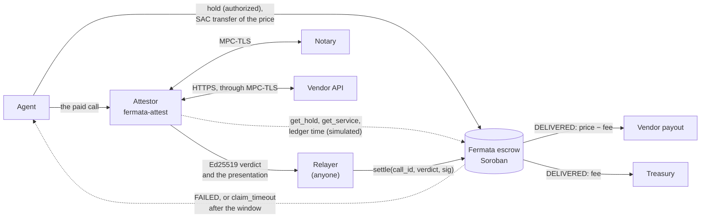

# Architecture

What is in this repository at Milestone 1, how the escrow and the attestor work on Stellar, and
where the later milestones attach. Differences from Fermata, with reasons, are in
[`PORTING_NOTES.md`](PORTING_NOTES.md).

## Components

| Path | What it is | Status |
|---|---|---|
| `contracts/escrow` | The Soroban escrow: a port of `FermataEscrow.sol` (Rust, `soroban-sdk` 29.0.1, 19.6 KB of Wasm) | M0, tested |
| `crates/fermata-verdict` | Verdict encoding, Ed25519 signing and strict verification, service-id derivation, registration hashes (ported from Fermata's attestor), and a CLI | M0, tested |
| `apps/attestor` | `fermata-attest`: the TLSNotary prover, notary and verifier from Fermata, reading the Soroban escrow and signing with `fermata-verdict`; its own workspace (Rust 1.95.0, TLSNotary `v0.1.0-alpha.15`) | M1, tested with real MPC-TLS sessions |
| `apps/vendor` | Fermata's demo vendor: a TLS 1.2 quote API with failure modes (500, truncated JSON, cut connection, hang) | M1, unchanged |
| `packages/sdk` | The TypeScript SDK: the escrow client generated by the Stellar CLI, the verdict encoding and signatures, the registration hashes | M1, tested |
| `test-vectors/` | Golden vectors (`verdict-v1.json`), the attestor's real verdicts (`attest-v1.json`) and an independent Python/OpenSSL checker | M0 and M1, checked in CI |
| `scripts/` | `deploy-testnet.sh`, `demo-cases.sh` (M0), `attest-cases.sh` (M1) and their shared `lib.sh` | Each runs 3/3 on a local network, in CI too |
| `predicates/quote-v1.json` | The demo service's delivery predicate, byte-identical to Fermata's | Enforced by the attestor |
| Gateway (MPP and x402 on Stellar), dashboard | Sells calls to agents, settles, reconciles from events | Planned, M2 |

## State machine

```mermaid
stateDiagram-v2
  [*] --> Held: hold (agent authorizes; price pulled)
  Held --> Released: settle, DELIVERED verdict, inside the window
  Held --> Refunded: settle, FAILED verdict, inside the window
  Held --> TimedOut: claim_timeout, after the window
  Released --> [*]
  Refunded --> [*]
  TimedOut --> [*]
```

A call id is usable once, ever. The window closes at `held_at + settlement_window`. `settle`
is accepted while the ledger timestamp is at most that deadline, and `claim_timeout` only once
it is past it. Every final status is permanent.

## Contract interface

| Function | Authorization | Effect | Contract errors |
|---|---|---|---|
| `__constructor(owner, treasury, fee_bps)` | none (runs at deployment) | Stores the owner, the treasury and the fee | `FeeTooHigh`, `InvalidRecipient` |
| `register_service(owner, label, payout, token, price_per_call, settlement_window, verifier, predicate_hash, origin_hash, notary_key_hash) → service_id` | `owner` | Stores an immutable service under `service_id(owner, label)` | `ServiceExists`, `InvalidVerifier`, `InvalidRecipient`, `InvalidService` |
| `hold(agent, call_id, service_id, request_hash)` | `agent`, including the token transfer of the exact price | Records the hold and the current fee, then pulls the price | `InvalidCall`, `CallIdUsed`, `UnknownService`; token errors pass through |
| `settle(call_id, verdict, signature)` | none (anyone) | Checks the window, the verdict fields and the Ed25519 signature; releases or refunds | `NotHeld`, `WindowClosed`, `CallIdMismatch`, `ServiceMismatch`, `RequestMismatch`, `PredicateMismatch`, `InvalidOutcome`, `InvalidPresentation`; a bad signature is a host crypto error |
| `claim_timeout(call_id)` | none (anyone) | After the window, refunds the agent | `NotHeld`, `WindowOpen` |
| `set_fee_bps(fee_bps)` | the escrow owner | New fee for future holds (at most 500) | `FeeTooHigh` |
| `set_treasury(treasury)` | the escrow owner | New treasury | `InvalidRecipient` |
| `owner()`, `treasury()`, `fee_bps()`, `get_service(id)`, `get_hold(call_id)`, `settlement_deadline(call_id)`, `service_id(owner, label)`, `verdict_message(verdict)` | none | Read-only views | |

`get_service` and `get_hold` return `None` for an unknown id. `get_hold` reports `amount` and
`deadline` only while a call is Held, as on Tempo.

## Token movements per step

Every movement is a Stellar Asset Contract (SAC) `transfer` in the same transaction as the
escrow's event, which carries the call id:

| Step | Escrow event | Token transfers |
|---|---|---|
| `hold` | `held` | agent → escrow (price) |
| `settle`, DELIVERED | `released` | escrow → payout (price − fee); escrow → treasury (fee), skipped when the fee rounds to 0 |
| `settle`, FAILED | `refunded` | escrow → agent (price) |
| `claim_timeout` | `timed_out` | escrow → agent (price) |

The fee is `floor(price × fee_bps / 10 000)` with the fee snapshotted at `hold`. Prices are
bounded by `MAX_PRICE = i128::MAX / 10 000`, so the product cannot overflow.

## Events

| Event | Topics | Data |
|---|---|---|
| `service_registered` | `service_id`, `owner`, `token` | `label`, `payout`, `verifier`, `price_per_call`, `settlement_window` |
| `held` | `call_id`, `service_id`, `agent` | `amount`, `request_hash` |
| `released` | `call_id`, `service_id`, `payout` | `amount`, `fee`, `presentation_hash` |
| `refunded` | `call_id`, `service_id`, `agent` | `amount`, `presentation_hash` |
| `timed_out` | `call_id`, `service_id`, `agent` | `amount` |
| `fee_bps_updated` | none | `fee_bps` |
| `treasury_updated` | `treasury` | none |

The event name is the first topic. Data is a map keyed by field name, the `#[contractevent]`
default. Events are not ledger state, and RPC providers typically keep them for about 7 days, so
long-term reconciliation needs an indexer (planned for Milestone 2).

## Storage and TTL

| Key | Storage | Contents | TTL |
|---|---|---|---|
| `Owner`, `Treasury`, `FeeBps` | instance | Configuration | Extended to 120 days whenever fewer than 60 remain, on every state-changing call |
| `Service(service_id)` | persistent | `Service` | The same, at registration and on every `hold` (a service outlives its open holds) |
| `Hold(call_id)` | persistent | `Hold`: agent, service id, request hash, `held_at`, fee snapshot, status | At `hold`: the window in ledgers (5 s per ledger, rounded up) plus a 7-day grace period for `claim_timeout`. Not extended after that |

All extensions are capped at the network's maximum TTL. When an entry's TTL runs out it is
archived, not deleted. A transaction that touches it restores it (automatically since protocol
23) and sees its real state. As a result:

- a finalised hold still blocks its call id;
- an open hold can still be settled or refunded;
- no rule depends on expiry, which matters because anyone can extend any entry's TTL.

The tests check all of this against the host's archival emulation (`src/tests/ttl.rs`).

## The verdict

The verifier signs, with Ed25519, a 294-byte message in which every field is fixed-width and
integers are big-endian:

| Offset | Bytes | Content |
|---|---|---|
| 0 | 26 | ASCII `FERMATA_STELLAR_VERDICT_V1` |
| 26 | 32 | network id = sha256(network passphrase), what `env.ledger().network_id()` returns |
| 58 | 32 | the escrow's contract id (the 32 bytes inside its `C…` address) |
| 90 | 32 | `call_id` |
| 122 | 32 | `service_id` |
| 154 | 32 | `request_hash` |
| 186 | 32 | `predicate_hash` |
| 218 | 4 | `outcome` (u32: 1 DELIVERED, 2 FAILED) |
| 222 | 32 | `presentation_hash` |
| 254 | 32 | `response_hash` |
| 286 | 8 | `issued_at` (u64, unix seconds; signed, not checked on-chain) |

The contract rebuilds these bytes and calls the host's `ed25519_verify`, which uses
`verify_strict`. The view `verdict_message(verdict)` returns them, so off-chain code can check
parity against a deployment.

**Hashes.** The registration and binding hashes are Fermata's, unchanged:

- `service_id = sha256("FERMATA_STELLAR_SERVICE_V1" ‖ XDR(ScVal::Address(owner)) ‖ label[12])`
- `request_hash = sha256(service_id ‖ METHOD ‖ request-target ‖ sha256(body))`
- `predicate_hash = sha256(predicate bytes)`
- `origin_hash = keccak256("https://" + host [+ ":" + port])`
- `notary_key_hash = keccak256(33-byte notary key)`

**Golden vectors.** `test-vectors/verdict-v1.json` pins the encoding. Three implementations agree
on it: the contract (in its tests), `fermata-verdict` (in its tests and its CLI tests) and
`test-vectors/check_vectors.py` (Python with OpenSSL's Ed25519).

## The attestor

`fermata-attest` is Fermata's attestor (`apps/attestor`): the TLSNotary code is copied unchanged,
and the chain reads and the signer are Stellar's. One verdict takes four steps.

1. **Prove.** The prover makes the paid HTTPS call over MPC-TLS together with the notary, which
   never sees plaintext and signs an attestation of the commitments. The request carries `Host`
   and `X-Fermata-Call: 0x<callId>`. Everything is revealed except the values of the
   `Authorization`, `Cookie` and `Proxy-Authorization` headers. An attempt has a timeout and is
   retried, because an MPC session occasionally stalls during setup.
2. **Verify the presentation.** The notary's signature, the server certificate against the trust
   roots (a dev CA, Mozilla's, or both) and the transcript commitments; hiding is allowed only
   inside the three header values.
3. **Bind it to the chain.** It reads the hold and its service from the escrow, then runs seven
   checks in Fermata's order. Any failure means no verdict:

   | # | Check | Compared against |
   |---|---|---|
   | 1 | notary | keccak256(the notary's key) = the service's `notary_key_hash` |
   | 2 | origin | the TLS server name and the `Host` header give the service's `origin_hash` |
   | 3 | request | the revealed method, target and body recompute the hold's `request_hash` |
   | 4 | predicate | sha256 of the predicate file = the service's `predicate_hash` |
   | 5 | hold | status Held, and the latest ledger's close time ≤ the hold's deadline |
   | 6 | call | the revealed `X-Fermata-Call` header = the call id, so an old proof cannot settle a new hold |
   | 7 | time | the TLS session time lies in `[held_at − 60 s, deadline]` |
4. **Decide and sign.** The delivery predicate runs on the revealed response (status set, content
   type, body size, a small JSON-schema subset). DELIVERED or FAILED goes into the verdict, with
   `presentation_hash = keccak256(presentation)` and `response_hash = keccak256(received bytes)`,
   signed with Ed25519 for one network and one escrow.

**Chain reads.** `get_hold` and `get_service` are read by simulating them
(`simulateTransaction`) from the all-zero account `GAAAA…WHF`. That account does not exist, and
simulation needs neither a funded account nor a signature, so the attestor holds no Stellar account.
Results are decoded strictly from XDR. Chain time comes from `getLatestLedger`'s `closeTime`. At
startup the attestor checks that the RPC serves the configured network passphrase and that the
escrow answers. A hold that reads as unknown is read again for up to 6 s, because a load-balanced
RPC can lag behind the hold.

**Interfaces.**

- **CLI.** `notary`, `prove`, `verify [--offline]`, `serve` and `hashes`, with the chain flags
  `--network`, `--rpc` and `--escrow`.
- **HTTP API** (`serve`). `POST /v1/attest`, `/v1/prove`, `/v1/verify` and `/v1/reverify`, and
  `GET /v1/presentations/<callId>` and `/healthz`. A failed binding check returns 422, and a
  missing transcript returns 502 with no verdict.
- **Keys.** The verdict key is read from `FERMATA_VERIFIER_SECRET`, an Ed25519 `S…` seed or hex.
  The notary's secp256k1 key is read from `NOTARY_PRIVATE_KEY`.

**Offline re-verification.** `fermata-attest verify --offline` needs no chain and no key: it
recomputes every hash in the verdict from a presentation and compares them with the values the
escrow stores.

## Error codes

| Code | Error | Code | Error |
|---|---|---|---|
| 101 | `FeeTooHigh` | 110 | `WindowClosed` |
| 102 | `InvalidRecipient` | 111 | `WindowOpen` |
| 103 | `InvalidVerifier` | 112 | `CallIdMismatch` |
| 104 | `InvalidService` | 113 | `ServiceMismatch` |
| 105 | `ServiceExists` | 114 | `RequestMismatch` |
| 106 | `UnknownService` | 115 | `PredicateMismatch` |
| 107 | `InvalidCall` | 116 | `InvalidOutcome` |
| 108 | `CallIdUsed` | 117 | `InvalidPresentation` |
| 109 | `NotHeld` | | |

Codes start at 101 because a failed token transfer propagates the Stellar Asset Contract's own
codes (1–15), for example 10 for an insufficient balance or 11 for a deauthorized balance.

## Testing

`cargo test --workspace` runs 90 tests, about 15 s once built (dependencies are optimized in the
dev profile). The attestor and the SDK have their own suites.

**`contracts/escrow` (62 tests).** Fermata's Solidity suite, ported case by case: section 6 of
`PORTING_NOTES.md` maps every case. Grouped by module:

- `register` (6), `hold` (8), `settle` (15), `lifecycle` (7), `admin` (4) and `tokens` (5): the
  ported cases, plus:
  - exact authorization trees;
  - token movements per step;
  - every verdict field tampered with after signing;
  - other networks and other escrows;
  - a hostile re-entrant token, a token that traps, and deauthorized recipients.
- `vectors` (4): the golden vectors rebuilt and settled on-chain.
- `attest_vector` (5): the verdicts the attestor signed for real TLSNotary presentations
  (`test-vectors/attest-v1.json`) settle, release and refund; their messages are rebuilt
  byte for byte; and they cannot settle another call. Ports Fermata's `AttestVector.t.sol`.
- `ttl` (5): TTL and archival.
- `props` (2): Foundry's fuzz tests as proptest properties, 512 cases each.
- `invariants` (1): Foundry's invariant suite as 128 random sequences of up to 64 holds,
  settlements, timeouts, time jumps, fee changes and replays. After every step it checks the
  escrow balance against open holds, the records against ghost state, and conservation.
- Mutation-checked during development: five injected bugs were each caught
  ([`security.md`](security.md)).

**`crates/fermata-verdict` (28 tests).** Encoding layout, signing and strict verification,
tampering, non-canonical signatures, strkeys, service ids, Fermata's hash vectors, the golden
vectors, and the CLI as the scripts drive it.

**`apps/attestor` (14 unit tests and an integration test).**

- **Unit tests.** The copied modules' own tests, plus XDR tests for the simulated reads (the
  transaction from the all-zero account, strict decoding of `HoldView` and `Service`).
- **Integration test.** It runs five real MPC-TLS sessions against the demo vendor through a
  notary process: a 200 quote, an authenticated 500, truncated JSON, another notary, and a
  forbidden redaction.
  - **Negative cases:** one per binding check, plus tampering, an unknown call and a vendor that
    never answers. None of them gets a verdict.
  - **Signatures:** every verdict's signature is checked with `fermata-verdict`.
  - **Vector:** it writes `test-vectors/attest-v1.json`.
- **Ignored tests.** A soak test and a test against a real third-party vendor
  (registry.npmjs.org) are ported as ignored tests.

**`packages/sdk` (19 tests, plus a live test).**

- **Parity with `verdict-v1.json`.** Every message and signature is reproduced. Signatures for
  other domains are rejected, and changing any field breaks the signature.
- **Parity with `attest-v1.json`.** The attestor's verdicts verify.
- **Fermata's hash vectors.**
- **Service-id derivation.**
- **Live test.** With `FERMATA_DEPLOYMENT`, it compares the deployed escrow's own `service_id`
  and `verdict_message` views with the SDK, through the generated client.

**On a network.** Each script ran 3/3 against a local quickstart network (stellar-core 29.0.0,
RPC 29.0.1, protocol 29, testnet resource limits), and the CI's end-to-end job runs them there on
every push:

- `scripts/deploy-testnet.sh`;
- `scripts/demo-cases.sh`, with script-signed verdicts;
- `scripts/attest-cases.sh`, with real proofs, offline re-verification against the chain and a
  replay check.

The testnet run is described in the README.

## Where later milestones attach

- **Milestone 2: the gateway.** It sits where the scripts sit today:
  - it calls the attestor's `POST /v1/attest`;
  - it offers a `fermata` MPP method and an escrowed x402 scheme;
  - it submits `settle`, sweeping expired holds with `claim_timeout`;
  - it reconciles from the escrow's events and the SAC's transfer events.

  The SDK's client and verdict functions are its Stellar layer. Neither the escrow nor the
  attestor changes.
