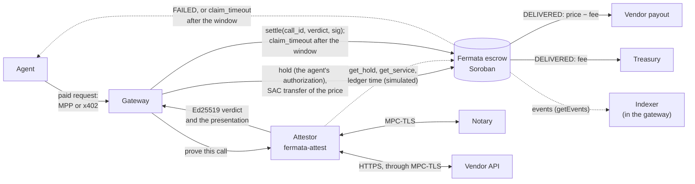

# Architecture

What is in this repository at Milestone 2: how the escrow, the session contract, the attestor and
the gateway work on Stellar, and where the later work attaches. Differences from Fermata, with reasons, are in
[`PORTING_NOTES.md`](PORTING_NOTES.md).

## Components

| Path | What it is | Status |
|---|---|---|
| `contracts/escrow` | The Soroban escrow: a port of `FermataEscrow.sol` (Rust, `soroban-sdk` 29.0.1, 19.6 KB of Wasm) | M0, tested |
| `contracts/session` | The session contract: one deposit for many calls of a service, settled in batches the verifier signs; it reads the escrow's registry, fee and treasury (22.6 KB of Wasm). New in this repository | M2 phase 1, tested |
| `crates/fermata-verdict` | Verdict encoding, Ed25519 signing and strict verification, service-id derivation, registration hashes (ported from Fermata's attestor), the session encodings (tickets, entries, statements, call ids, the sample), and a CLI | M0 and M2 phase 1, tested |
| `apps/attestor` | `fermata-attest`: the TLSNotary prover, notary and verifier from Fermata, reading the Soroban escrow and signing with `fermata-verdict`; its own workspace (Rust 1.95.0, TLSNotary `v0.1.0-alpha.15`). M2 phase 1: it proves the calls of sessions and signs their batch statements | M1 and M2 phase 1, tested with real MPC-TLS sessions |
| `apps/vendor` | Fermata's demo vendor: a TLS 1.2 quote API with failure modes (500, truncated JSON, cut connection, hang) | M1, unchanged |
| `packages/sdk` | The TypeScript SDK. M1: the escrow client generated by the Stellar CLI, the verdict encoding and signatures, the registration hashes. M2: holds (sponsored and direct), the `fermata` MPP method, the `fermata` x402 scheme, a client for OpenZeppelin's Channels service, an event indexer, reconciliation and vendor scores. M2 phase 1: the session contract's client, the session encodings, opening, settling and closing sessions, the MPP `session` intent, and session reconciliation | M1 and M2, tested |
| `apps/gateway` | The gateway: sells calls through MPP and x402, holds, has the attestor prove each call, settles, sweeps timed-out holds, indexes events, and serves the read API and the dashboard (Hono 4, Node 22). M2 phase 1: sessions through MPP, settled in batches and closed after their deadline | M2, tested on a local network |
| `apps/dashboard` | Fermata's dashboard (React 19, Vite 7): live calls and events, the proof drawer with offline re-verification, reconciliation, vendor scores | M2, typechecks and builds |
| `test-vectors/` | Golden vectors (`verdict-v1.json`, `session-v1.json`), the attestor's real verdicts (`attest-v1.json`) and batch statement (`session-attest-v1.json`), and an independent Python/OpenSSL checker | M0, M1 and M2 phase 1, checked in CI |
| `scripts/` | `deploy-testnet.sh`, `demo-cases.sh` (M0), `attest-cases.sh` (M1), `session-cases.sh` (M2 phase 1), `gateway-cases.sh` (M2), their shared `lib.sh`, and `lib/tls-proxy.mjs` (HTTPS in front of a local RPC) | Each passes on a local network, in CI too |
| `predicates/quote-v1.json` | The demo service's delivery predicate, byte-identical to Fermata's | Enforced by the attestor |
| Sampled proving | Prove an unpredictable sample of a session's calls (k > 1) | Phase 2, not built. The session contract already settles sampled batches; the attestor and the gateway take only k = 1 |



`settle` and `claim_timeout` need no authorization, so anyone holding a signed verdict, or anyone
at all after the window, can submit them; the gateway is simply the party that does.

## State machine

```mermaid
stateDiagram-v2
  [*] --> Held: hold (agent authorizes; price pulled)
  Held --> Released: settle, DELIVERED verdict, inside the window
  Held --> Refunded: settle, FAILED verdict, inside the window
  Held --> TimedOut: claim_timeout, after the window
  Released --> [*]
  Refunded --> [*]
  TimedOut --> [*]
```



A call id is usable once, ever. The window closes at `held_at + settlement_window`. `settle`
is accepted while the ledger timestamp is at most that deadline, and `claim_timeout` only once
it is past it. Every final status is permanent.

## Contract interface

| Function | Authorization | Effect | Contract errors |
|---|---|---|---|
| `__constructor(owner, treasury, fee_bps)` | none (runs at deployment) | Stores the owner, the treasury and the fee | `FeeTooHigh`, `InvalidRecipient` |
| `register_service(owner, label, payout, token, price_per_call, settlement_window, verifier, predicate_hash, origin_hash, notary_key_hash) → service_id` | `owner` | Stores an immutable service under `service_id(owner, label)` | `ServiceExists`, `InvalidVerifier`, `InvalidRecipient`, `InvalidService` |
| `hold(agent, call_id, service_id, request_hash)` | `agent`, including the token transfer of the exact price | Records the hold and the current fee, then pulls the price | `InvalidCall`, `CallIdUsed`, `UnknownService`; token errors pass through |
| `settle(call_id, verdict, signature)` | none (anyone) | Checks the window, the verdict fields and the Ed25519 signature; releases or refunds | `NotHeld`, `WindowClosed`, `CallIdMismatch`, `ServiceMismatch`, `RequestMismatch`, `PredicateMismatch`, `InvalidOutcome`, `InvalidPresentation`; a bad signature is a host crypto error |
| `claim_timeout(call_id)` | none (anyone) | After the window, refunds the agent | `NotHeld`, `WindowOpen` |
| `set_fee_bps(fee_bps)` | the escrow owner | New fee for future holds (at most 500) | `FeeTooHigh` |
| `set_treasury(treasury)` | the escrow owner | New treasury | `InvalidRecipient` |
| `owner()`, `treasury()`, `fee_bps()`, `get_service(id)`, `get_hold(call_id)`, `settlement_deadline(call_id)`, `service_id(owner, label)`, `verdict_message(verdict)` | none | Read-only views | |

`get_service` and `get_hold` return `None` for an unknown id. `get_hold` reports `amount` and
`deadline` only while a call is Held, as on Tempo.

## Token movements per step

Every movement is a Stellar Asset Contract (SAC) `transfer` in the same transaction as the
escrow's event, which carries the call id:

| Step | Escrow event | Token transfers |
|---|---|---|
| `hold` | `held` | agent → escrow (price) |
| `settle`, DELIVERED | `released` | escrow → payout (price − fee); escrow → treasury (fee), skipped when the fee rounds to 0 |
| `settle`, FAILED | `refunded` | escrow → agent (price) |
| `claim_timeout` | `timed_out` | escrow → agent (price) |

The fee is `floor(price × fee_bps / 10 000)` with the fee snapshotted at `hold`. Prices are
bounded by `MAX_PRICE = i128::MAX / 10 000`, so the product cannot overflow.

## Events

| Event | Topics | Data |
|---|---|---|
| `service_registered` | `service_id`, `owner`, `token` | `label`, `payout`, `verifier`, `price_per_call`, `settlement_window` |
| `held` | `call_id`, `service_id`, `agent` | `amount`, `request_hash` |
| `released` | `call_id`, `service_id`, `payout` | `amount`, `fee`, `presentation_hash` |
| `refunded` | `call_id`, `service_id`, `agent` | `amount`, `presentation_hash` |
| `timed_out` | `call_id`, `service_id`, `agent` | `amount` |
| `fee_bps_updated` | none | `fee_bps` |
| `treasury_updated` | `treasury` | none |

The event name is the first topic. Data is a map keyed by field name, the `#[contractevent]`
default. Events are not ledger state, and RPC providers typically keep them for about 7 days, so
the gateway's indexer keeps its own copy ([below](#indexer-and-reconciliation)).

## Storage and TTL

| Key | Storage | Contents | TTL |
|---|---|---|---|
| `Owner`, `Treasury`, `FeeBps` | instance | Configuration | Extended to 120 days whenever fewer than 60 remain, on every state-changing call |
| `Service(service_id)` | persistent | `Service` | The same, at registration and on every `hold` (a service outlives its open holds) |
| `Hold(call_id)` | persistent | `Hold`: agent, service id, request hash, `held_at`, fee snapshot, status | At `hold`: the window in ledgers (5 s per ledger, rounded up) plus a 7-day grace period for `claim_timeout`. Not extended after that |

All extensions are capped at the network's maximum TTL. When an entry's TTL runs out it is
archived, not deleted. A transaction that touches it restores it (automatically since protocol
23) and sees its real state. As a result:

- a finalised hold still blocks its call id;
- an open hold can still be settled or refunded;
- no rule depends on expiry, which matters because anyone can extend any entry's TTL.

The tests check all of this against the host's archival emulation (`src/tests/ttl.rs`).

## The verdict

The verifier signs, with Ed25519, a 294-byte message in which every field is fixed-width and
integers are big-endian:

| Offset | Bytes | Content |
|---|---|---|
| 0 | 26 | ASCII `FERMATA_STELLAR_VERDICT_V1` |
| 26 | 32 | network id = sha256(network passphrase), what `env.ledger().network_id()` returns |
| 58 | 32 | the escrow's contract id (the 32 bytes inside its `C…` address) |
| 90 | 32 | `call_id` |
| 122 | 32 | `service_id` |
| 154 | 32 | `request_hash` |
| 186 | 32 | `predicate_hash` |
| 218 | 4 | `outcome` (u32: 1 DELIVERED, 2 FAILED) |
| 222 | 32 | `presentation_hash` |
| 254 | 32 | `response_hash` |
| 286 | 8 | `issued_at` (u64, unix seconds; signed, not checked on-chain) |

The contract rebuilds these bytes and calls the host's `ed25519_verify`, which uses
`verify_strict`. The view `verdict_message(verdict)` returns them, so off-chain code can check
parity against a deployment.

**Hashes.** The registration and binding hashes are Fermata's, unchanged:

- `service_id = sha256("FERMATA_STELLAR_SERVICE_V1" ‖ XDR(ScVal::Address(owner)) ‖ label[12])`
- `request_hash = sha256(service_id ‖ METHOD ‖ request-target ‖ sha256(body))`
- `predicate_hash = sha256(predicate bytes)`
- `origin_hash = keccak256("https://" + host [+ ":" + port])`
- `notary_key_hash = keccak256(33-byte notary key)`

**Golden vectors.** `test-vectors/verdict-v1.json` pins the encoding. Three implementations agree
on it: the contract (in its tests), `fermata-verdict` (in its tests and its CLI tests) and
`test-vectors/check_vectors.py` (Python with OpenSSL's Ed25519).

## The attestor

`fermata-attest` is Fermata's attestor (`apps/attestor`): the TLSNotary code is copied unchanged,
and the chain reads and the signer are Stellar's. One verdict takes four steps.

1. **Prove.** The prover makes the paid HTTPS call over MPC-TLS together with the notary, which
   never sees plaintext and signs an attestation of the commitments. The request carries `Host`
   and `X-Fermata-Call: 0x<callId>`. Everything is revealed except the values of the
   `Authorization`, `Cookie` and `Proxy-Authorization` headers. An attempt has a timeout and is
   retried, because an MPC session occasionally stalls during setup.
2. **Verify the presentation.** The notary's signature, the server certificate against the trust
   roots (a dev CA, Mozilla's, or both) and the transcript commitments; hiding is allowed only
   inside the three header values.
3. **Bind it to the chain.** It reads the hold and its service from the escrow, then runs seven
   checks in Fermata's order. Any failure means no verdict:

   | # | Check | Compared against |
   |---|---|---|
   | 1 | notary | keccak256(the notary's key) = the service's `notary_key_hash` |
   | 2 | origin | the TLS server name and the `Host` header give the service's `origin_hash` |
   | 3 | request | the revealed method, target and body recompute the hold's `request_hash` |
   | 4 | predicate | sha256 of the predicate file = the service's `predicate_hash` |
   | 5 | hold | status Held, and the latest ledger's close time ≤ the hold's deadline |
   | 6 | call | the revealed `X-Fermata-Call` header = the call id, so an old proof cannot settle a new hold |
   | 7 | time | the TLS session time lies in `[held_at − 60 s, deadline]` |
4. **Decide and sign.** The delivery predicate runs on the revealed response (status set, content
   type, body size, a small JSON-schema subset). DELIVERED or FAILED goes into the verdict, with
   `presentation_hash = keccak256(presentation)` and `response_hash = keccak256(received bytes)`,
   signed with Ed25519 for one network and one escrow.

**Chain reads.** `get_hold` and `get_service` are read by simulating them
(`simulateTransaction`) from the all-zero account `GAAAA…WHF`. That account does not exist, and
simulation needs neither a funded account nor a signature, so the attestor holds no Stellar account.
Results are decoded strictly from XDR. Chain time comes from `getLatestLedger`'s `closeTime`. At
startup the attestor checks that the RPC serves the configured network passphrase and that the
escrow answers. A hold that reads as unknown is read again for up to 6 s, because a load-balanced
RPC can lag behind the hold.

**Interfaces.**

- **CLI.** `notary`, `prove`, `verify [--offline]`, `serve` and `hashes`, with the chain flags
  `--network`, `--rpc` and `--escrow`.
- **HTTP API** (`serve`). `POST /v1/attest`, `/v1/prove`, `/v1/verify` and `/v1/reverify`, and
  `GET /v1/presentations/<callId>` and `/healthz`. A failed binding check returns 422, and a
  missing transcript returns 502 with no verdict.
- **Keys.** The verdict key is read from `FERMATA_VERIFIER_SECRET`, an Ed25519 `S…` seed or hex.
  The notary's secp256k1 key is read from `NOTARY_PRIVATE_KEY`.

**Offline re-verification.** `fermata-attest verify --offline` needs no chain and no key: it
recomputes every hash in the verdict from a presentation and compares them with the values the
escrow stores.

## The gateway

`apps/gateway` is Fermata's gateway, ported to Stellar. It sells calls to a vendor's API at
`/s/<serviceId>/<path>` and turns each paid call into a hold, a proof and a settlement.

**The offer.** An unpaid request gets one 402 that lists every way to pay for it:

- **MPP.** A `fermata` challenge in `WWW-Authenticate`. It is bound to this exact request by its
  request hash, and carries a call id the gateway mints inside the HMAC-bound challenge.
- **x402 (v2).** The `fermata` requirements in `PAYMENT-REQUIRED`. Their call id is an HMAC, under
  the gateway's key, over the escrow, the service, the request hash, a salt and an expiry (5
  minutes). The gateway can therefore recognize requirements it issued without storing them.
- **Unprotected options.** Stellar's MPP Charge and x402 `exact`, for a service that configures
  an `unprotected` recipient.

**The hold.** Before signing anything, the agent's client checks the escrow and the service's
verifier against its allow-lists, and the price and the settlement window against its limits. It
then pays in one of three ways:

| Way to pay | The agent sends | The gateway checks | Who submits `hold` |
|---|---|---|---|
| MPP `fermata`, credential `transaction` (sponsored; the client's default) | The `hold` transaction with its signed authorization entry, built with the all-zero account as source | The entry authorizes exactly this hold: one sub-invocation, the token transfer of the price into the escrow, and nothing deeper. It expires within the challenge's lifetime (at most 5 minutes, plus 10 ledgers of skew) and its signature verifies. The call id is unused. A simulation in enforce mode emits the `held` event and only that transfer | The gateway's relayer account, or OpenZeppelin Channels |
| MPP `fermata`, credential `hold` | The hash of a `hold` the agent submitted itself | The transaction succeeded on this escrow, its `held` event has this call, service, request hash and amount, and the hold is still open | The agent |
| x402 `fermata` | The same signed transaction, as the x402 payload | The requirements are ones the gateway issued for this request, unexpired. Then the checks of a sponsored MPP hold, with the expiry bounded by `maxTimeoutSeconds` (60 s, plus the same skew) | The gateway's in-process facilitator: the relayer account, or OpenZeppelin Channels |

A sponsored hold is recorded (`holding`) before it is submitted. So if the submission's outcome is
lost and the hold lands anyway, the sweeper still finds it.

**Prove and settle.**

1. **Record.** The gateway writes the call to its store: one JSON file per call, written
   atomically.
2. **Prove.** It asks the attestor to prove the call (`POST /v1/attest`), with the vendor's
   credential header added from the gateway's environment.
3. **Settle.** It submits `settle` with the signed verdict.
4. **Answer.** The agent gets the proved response, with these headers:
   - for MPP, a `Payment-Receipt` that names the call, its hold and its settlement;
   - for x402, a `PAYMENT-RESPONSE` naming the hold transaction;
   - in both cases, `X-Fermata-Call`, `-Status`, `-Outcome`, `-Hold-Tx` and `-Settle-Tx`.

When the attestor returns no verdict, the gateway never settles. That happens with no transcript
(answered 504) or with a failed binding check (502); the sweeper refunds the agent after the
window.

**Call statuses.**

- **On the way:** `holding` (a sponsored hold being submitted), `held` (proving), `settle-pending`
  (a signed verdict whose `settle` failed) and `awaiting-timeout` (no verdict).
- **Final:** `released`, `refunded`, `timed-out` and `closed`.

**The sweeper.** It runs every 10 s by default and never overlaps itself. It:

- retries a pending settlement while the window is open;
- sends `claim_timeout` once the window has passed;
- records outcomes that someone else finalised on chain;
- closes a sponsored hold that never landed after 15 minutes.

A call cut off by a restart in the middle of proving is treated like `awaiting-timeout`, so the
agent is still refunded.

**Admission control.** While `GATEWAY_MAX_IN_FLIGHT` calls (default 4) are being paid for or
proved, new payers get a 503 before they pay anything. Requests that already carry a payment are
always served. The sweeper leaves those calls alone, whatever their status, and reads each record
again before acting on it.

**The unprotected options.**

- **Libraries.** Stellar's MPP Charge comes from `@stellar/mpp`, pinned to a commit of its
  unreleased main branch; x402 `exact` comes from `@x402/stellar` 2.28.0.
- **What happens.** Both pay the configured recipient directly. The gateway then forwards the
  request to the vendor and marks the response `X-Fermata-Unprotected: true`.
- **Who settles `exact`.** A hosted facilitator when `X402_FACILITATOR_URL` is set (OpenZeppelin's
  accepts only `exact`); otherwise a facilitator in the gateway's process, paying fees from
  `FEE_PAYER_SECRET` (default: the relayer).

**Read API.** None of it is authenticated:

- **Calls and services:** `/services`, `/scores`, `/calls`, `/calls/:callId` and `/info`.
- **Proofs:** `/proofs/:callId` (the presentation), `POST /proofs/:callId/verify` (re-verified
  offline by the attestor, with every hash compared against the chain), `/ca.pem` and
  `/predicates/:hash`.
- **Indexed events:** `/events`, `/reconcile/:callId` and `/reconcile`.
- **Discovery:** `/llms.txt` and MPP's discovery document.
- **The dashboard:** `/dashboard/`.

**Keys and settings.** Secrets come only from the environment:

- `FERMATA_RELAYER_SECRET`: the account that submits holds, settlements and timeouts.
- `GATEWAY_SECRET_KEY`: the HMAC key for MPP challenges and x402 call ids, at least 32 bytes.
- Optional: `FEE_PAYER_SECRET`, `OZ_CHANNELS_API_KEY` and `X402_FACILITATOR_API_KEY`.

Everything else is in a JSON config ([`gateway.config.example.json`](../apps/gateway/gateway.config.example.json))
or environment overrides ([`config.ts`](../apps/gateway/src/config.ts)). At startup the gateway
also checks:

- that the RPC serves the configured network passphrase;
- for each service, that its on-chain verifier is the attestor's key;
- that its pinned origin matches the configured upstream.

## Indexer and reconciliation

**The indexer** (`EscrowIndexer` in `packages/sdk`) follows one escrow:

- **What it reads.** It polls `getEvents` for the escrow's events and for the `transfer` events of
  each token into and out of the escrow. Topic filters: `["transfer", *, escrow, **]` and
  `["transfer", escrow, *, **]`.
- **New tokens.** Tokens are learned from `service_registered`. A new token's transfers are
  backfilled from the ledger of its registration.
- **Paging.** Each poll reads until its cursor reaches the RPC's latest ledger. A short page is not
  enough to stop on: the RPC scans at most 10,000 ledgers per request.
- **Storage.** Events are appended to `events.jsonl` and the cursor is kept in `state.json`, so a
  restart resumes where it stopped.
- **Where history starts.** At the escrow's deployment ledger (`escrow.deploy_ledger` in the
  deployment file), or at the oldest ledger the RPC still has. Anything the RPC no longer keeps
  is recorded as a gap; only a data lake or a third-party indexer could fill it.

**Reconciling one call** (`reconcileCall`, `GET /reconcile/:callId`) joins its escrow events with
the token transfers in the same transactions, and checks:

- the call was held exactly once;
- the hold moved the price from the agent into the escrow;
- it was settled at most once, for the held amount;
- a release paid `price − fee` to the payout and the fee to the treasury (the treasury in force at
  the time), and nothing else;
- a refund or a timeout returned the price to the agent, and nothing else.

The gateway's endpoint also checks that its own record agrees with the chain.

**Reconciling the whole escrow** (`reconcileEscrow`, `GET /reconcile`) reconciles every call, and
compares per token: transfers in minus transfers out, the open holds, and the token's own
`balance(escrow)`. The balance comparison is made only when the index has no gap since the
deployment.

**Vendor scores** (`GET /scores`) are Fermata's, read from the same events.

- **The rate.** Each service's delivery rate counts proven outcomes only: releases against
  verified failures. Services are ranked by the rate's Wilson lower bound (95 %).
- **Timeouts** are reported but not counted. Anyone can hold a call and never present it, so a
  timeout proves nothing about the vendor.
- **Fermata's caveats.** Only calls paid through Fermata count, and a vendor can pay itself to
  raise its score, so the number of distinct agents is shown too.

## Sessions (Milestone 2, phase 1)

A session holds one deposit for up to `max_calls` calls of one service, and its calls are settled
in batches of at most B. In phase 1 every call is proved (k = 1). The exact encodings and rules
are in section 10 of [`session-escrow.md`](session-escrow.md#10-phase-1-specification); this
section is the overview.

```mermaid
sequenceDiagram
  autonumber
  participant Ag as Agent
  participant Gw as Gateway
  participant Se as Session contract
  participant Es as Escrow
  participant At as Attestor
  Ag->>Gw: first paid call: its authorization of open_session, and its ticket for call 1
  Gw->>Se: open_session, submitted and paid for by the gateway
  Se->>Es: get_service and fee_bps: the service's terms and the fee
  Note over Se: deposit = max_calls × price, pulled from the agent
  loop each call n
    Ag->>Gw: call n, with its ticket over chain(n)
    Gw->>At: prove call n
    At->>Se: get_session (simulated)
    Note over At: the session and the ticket are checked before the vendor is contacted
    At-->>Gw: the entry: DELIVERED or FAILED with its hashes, or UNANSWERED with none
    Gw-->>Ag: the vendor's response, with a receipt
  end
  Gw->>At: the statement for calls settled + 1 to n
  Gw->>Se: settle_batch (anyone may submit it)
  Se->>Es: treasury
  Note over Se: DELIVERED pays price − fee and the fee; FAILED and UNANSWERED go back to the agent
  Gw->>Se: close_session after the deadline (anyone may): the rest goes back to the agent
```

**States.** A session is Open from `open_session` until the batch that settles call `max_calls`,
or until `close_session` after its deadline; then it is Closed. Batches are accepted until the
deadline, `expires_at + settlement_window`. A session id is usable once, ever.

| Function | Authorization | Effect | Contract errors |
|---|---|---|---|
| `__constructor(escrow)` | none (runs at deployment) | Stores the escrow it reads | |
| `open_session(agent, session_id, service_id, max_calls, ticket_key, sample_k, batch_size, seed, expires_at)` | `agent`, including the token transfer of the deposit | Copies the service's terms and the escrow's fee, records the session, pulls `max_calls × price` | `InvalidSession`, `SessionExists`, `UnknownService`; token errors pass through |
| `settle_batch(session_id, to, request_hashes, ticket, seed, entries, statement)` | none (anyone) | Checks the agent's ticket for call `to` and the verifier's statement over calls `settled + 1` to `to`, then pays and refunds them | `NotOpen`, `WindowClosed`, `InvalidBatch`, `LengthMismatch`, `InvalidSeed`, `InvalidEntry`, `InvalidRecipient`; a bad signature is a host crypto error |
| `close_session(session_id)` | none (anyone) | After the deadline, returns the calls not settled to the agent | `NotOpen`, `WindowOpen` |
| `escrow()`, `get_session(id)`, `ticket_message(session_id, n, chain)`, `statement_message(...)`, `call_id(session_id, n)`, `sampled(seed, n, k)` | none | Read-only views | |

**Token movements.** With k = 1, a batch pays each DELIVERED call `price − fee` to the payout and
the fee to the treasury, and returns each FAILED or UNANSWERED call's price to the agent. The fee
is `floor(price × fee_bps / 10 000)`, with `fee_bps` snapshotted at opening; the treasury is read
from the escrow at each batch. `close_session` returns `(max_calls − settled) × price`. Every
movement is a SAC `transfer` in the same transaction as the session's event.

| Event | Topics | Data |
|---|---|---|
| `session_opened` | `session_id`, `service_id`, `agent` | `deposit`, `max_calls`, `price`, `sample_k`, `batch_size`, `deadline` |
| `batch_settled` | `session_id`, `service_id` | `from`, `to`, the counts of `delivered`, `failed`, `answered` and `unanswered` calls, `paid`, `payout_amount`, `fee`, `refund`, `chain`, `entries_hash` |
| `session_closed` | `session_id`, `service_id`, `agent` | `refund` |

**Storage and TTL.** The escrow's address is in instance storage, extended to 120 days whenever
fewer than 60 remain. `Session(session_id)` is persistent: at opening its TTL is set to the time
until its deadline plus a 7-day grace period for `close_session`, and batches do not extend it. As
in the escrow, an archived session is restored by the next transaction that touches it, so a
closed session still blocks its id and an open one can still be closed
(`contracts/session/src/tests/ttl.rs`).

**The attestor and the gateway.** The attestor proves each call against the session and the
agent's ticket instead of a hold, keeps a book of each session's calls, and signs statements only
over calls it recorded. The gateway sells sessions through the `session` intent of the `fermata`
MPP method, takes one call of a session at a time, settles a batch when B calls are recorded, when
the session has expired or when it is full, and closes the session after its deadline. A call that
gets no proof is recorded UNANSWERED and refunded with its batch. Details: section 10 of
[`session-escrow.md`](session-escrow.md#10-phase-1-specification).

## Error codes

| Code | Error | Code | Error |
|---|---|---|---|
| 101 | `FeeTooHigh` | 110 | `WindowClosed` |
| 102 | `InvalidRecipient` | 111 | `WindowOpen` |
| 103 | `InvalidVerifier` | 112 | `CallIdMismatch` |
| 104 | `InvalidService` | 113 | `ServiceMismatch` |
| 105 | `ServiceExists` | 114 | `RequestMismatch` |
| 106 | `UnknownService` | 115 | `PredicateMismatch` |
| 107 | `InvalidCall` | 116 | `InvalidOutcome` |
| 108 | `CallIdUsed` | 117 | `InvalidPresentation` |
| 109 | `NotHeld` | | |

Codes start at 101 because a failed token transfer propagates the Stellar Asset Contract's own
codes (1–15), for example 10 for an insufficient balance or 11 for a deauthorized balance.

The session contract's codes start at 201:

| Code | Error | Code | Error |
|---|---|---|---|
| 201 | `InvalidSession` | 207 | `InvalidBatch` |
| 202 | `SessionExists` | 208 | `LengthMismatch` |
| 203 | `UnknownService` | 209 | `InvalidSeed` |
| 204 | `NotOpen` | 210 | `InvalidEntry` |
| 205 | `WindowClosed` | 211 | `InvalidRecipient` |
| 206 | `WindowOpen` | | |

## Testing

`cargo test --workspace` runs 160 tests (dependencies are optimized in the dev profile), and
leaves one ignored: the session contract's cost test, which needs the built Wasm and runs in CI
after the builds. The attestor, the SDK and the gateway have their own suites.

**`contracts/escrow` (62 tests).** Fermata's Solidity suite, ported case by case: section 6 of
`PORTING_NOTES.md` maps every case. Grouped by module:

- `register` (6), `hold` (8), `settle` (15), `lifecycle` (7), `admin` (4) and `tokens` (5): the
  ported cases, plus:
  - exact authorization trees;
  - token movements per step;
  - every verdict field tampered with after signing;
  - other networks and other escrows;
  - a hostile re-entrant token, a token that traps, and deauthorized recipients.
- `vectors` (4): the golden vectors rebuilt and settled on-chain.
- `attest_vector` (5): the verdicts the attestor signed for real TLSNotary presentations
  (`test-vectors/attest-v1.json`) settle, release and refund; their messages are rebuilt
  byte for byte; and they cannot settle another call. Ports Fermata's `AttestVector.t.sol`.
- `ttl` (5): TTL and archival.
- `props` (2): Foundry's fuzz tests as proptest properties, 512 cases each.
- `invariants` (1): Foundry's invariant suite as 128 random sequences of up to 64 holds,
  settlements, timeouts, time jumps, fee changes and replays. After every step it checks the
  escrow balance against open holds, the records against ghost state, and conservation.
- Mutation-checked during development: five injected bugs were each caught
  ([`security.md`](security.md)).

**`contracts/session` (54 tests, and the ignored cost test).** New in this repository:

- `open` (13): the deposit and its exact authorization tree, the terms copied from the escrow's
  registry, the fee snapshot, the limits, an unknown service, a used session id, a payout that is
  the contract itself, and an agent without the deposit.
- `settle` (23): payment per result, the treasury, replay, tickets and statements by other keys,
  sessions or contracts, a request the agent did not sign, entries changed after signing, the
  entry rules, the batch bounds, the deadline, and the batch that ends a session. Sampled
  sessions (k > 1) are tested here too: the sample, seeds revealed in chain order, a short batch,
  and the penalty, which never takes a batch below zero.
- `close` (6): the deadline, the refund of the calls not settled, anyone can close, and a closed or
  unknown session cannot be.
- `ttl` (6): the session's TTL, the instance's, and archived sessions.
- `vectors` (3): `test-vectors/session-v1.json` rebuilt by the contract, and its batches settled
  with the recorded signatures.
- `attest_vector` (2): the statement the attestor signed over three real session calls
  (`test-vectors/session-attest-v1.json`) settles, and settles nothing else.
- `invariants` (1): random sequences of openings, batches, closes, time jumps, fee changes,
  replays and tampering across three services, two tokens and three agents. After every step it
  checks the contract's balance against the open sessions, the records against ghost state, and
  conservation.
- `cost` (ignored): what `settle_batch` costs on the built Wasm, from 1 to 1,000 calls
  ([`session-escrow.md`](session-escrow.md#10-phase-1-specification)).

**`crates/fermata-verdict` (44 tests).** Encoding layout, signing and strict verification,
tampering, non-canonical signatures, strkeys, service ids, Fermata's hash vectors, the golden
vectors, and the CLI as the scripts drive it. For sessions: the ticket and statement layouts, the
chain, call ids, the entries hash, the sample and the seed chain, `session-v1.json`, and the CLI's
session commands.

**`apps/attestor` (26 unit tests and two integration tests).**

- **Unit tests.** The copied modules' own tests, plus XDR tests for the simulated reads (the
  transaction from the all-zero account, strict decoding of `HoldView`, `Service` and `Session`).
  Sessions (11): admission of the next call with a ticket for its request, every binding check
  failing closed, calls taken in order and once each, the expiry and the deadline, the book across
  a restart, and the statements it signs and refuses.
- **Integration test.** It runs five real MPC-TLS sessions against the demo vendor through a
  notary process: a 200 quote, an authenticated 500, truncated JSON, another notary, and a
  forbidden redaction.
  - **Negative cases:** one per binding check, plus tampering, an unknown call and a vendor that
    never answers. None of them gets a verdict.
  - **Signatures:** every verdict's signature is checked with `fermata-verdict`.
  - **Vector:** it writes `test-vectors/attest-v1.json`.
- **Session integration test.** Three calls of a session against the demo vendor, with the
  agent's tickets: a quote proved DELIVERED, an unknown symbol (a 404) proved FAILED, and a call
  recorded UNANSWERED. A ticket that does not cover the request is refused before any proof, and a
  proof made for another call's header does not bind. It writes
  `test-vectors/session-attest-v1.json`, the statement over the three calls.
- CI runs both integration tests.
- **Ignored tests.** A soak test and a test against a real third-party vendor
  (registry.npmjs.org) are ported as ignored tests.

**`packages/sdk` (81 tests, plus 19 live tests).**

- **Parity with `verdict-v1.json`.** Every message and signature is reproduced. Signatures for
  other domains are rejected, and changing any field breaks the signature.
- **Parity with `attest-v1.json`.** The attestor's verdicts verify.
- **Fermata's hash vectors.**
- **Service-id derivation.**
- **Holds (11).** The sponsor's checks accept exactly one hold and its transfer of the price, and
  refuse each variation:
  - another call, service, request, contract, token, amount or agent;
  - a deeper authorization tree;
  - another key or network;
  - an expired authorization, or one valid for too long;
  - an invocation other than the authorized one;
  - a source other than the all-zero account;
  - a tampered signature;
  - extra transfers or a missing event.
- **x402 (2).** Requirements carry a fresh call id each time, and are accepted back only
  unchanged, from this server, for this request, before they expire.
- **OpenZeppelin Channels (3).** The request and its answer, against a fake.
- **Indexer paging (2).** Against a fake RPC with stellar-rpc's 10,000-ledger scan window, a poll
  reads on to the latest ledger.
- **Reconciliation (6) and scores (5).** Reconciliation runs on recorded event sequences: a
  release, a refund, a timeout and an open hold, plus wrong amounts, a second settlement, a hold
  missing from the index and the per-token balances. The scores tests are Fermata's, on Stellar's
  events. `eventually` (2) is copied unchanged.
- **Sessions (31).**
  - Parity with `session-v1.json`: every chain, call id, ticket and statement, and their
    signatures. Signatures for another key, session, call or network are rejected.
  - The entry rules and what a batch pays.
  - The sponsor's check of a signed `open_session`, refusing every variation, as for holds.
  - The money an opening moves.
  - The session events.
  - The `settle_batch` and `close_session` invocations.
  - Session reconciliation (7): an open session, one its last batch ends, one closed after its
    deadline, wrong amounts, a gap between batches, and the contract's balance, including
    sessions of services the caller does not know.
- **Live tests.** They run with `FERMATA_DEPLOYMENT`, the agent's and the relayer's keys, against
  a deployment:
  - the deployed escrow's own `service_id` and `verdict_message` views agree with the SDK;
  - a sponsored hold, a direct hold, and a hold through a stand-in Channels service that
    implements its documented API;
  - the MPP method, sponsored and direct, refusing an untrusted verifier or escrow, another
    network, another server's challenge and another request;
  - the x402 scheme through `@x402/fetch`, refusing requirements the server did not issue and an
    untrusted verifier;
  - the indexer: it persists, resumes, and reconciles every call and the balance;
  - sessions: the deployed contract builds tickets, statements, call ids and the sample as the
    SDK does; a sponsored session through the relayer, with a DELIVERED and a FAILED call
    settled; and a session the agent opens itself, with an unanswered call refunded and the
    session closed.

**`apps/gateway` (32 tests).** Ported from Fermata's `gateway.test.ts`, against a fake chain and a
fake attestor:

- **The three outcomes:** DELIVERED, FAILED, and no transcript, refunded by the sweeper after the
  window.
- **The sweeper's edge cases:** overlapping sweeps; a call cut off by a restart; a call finalised
  by someone else; a sponsored hold that landed and one that never did; a failed `settle` retried
  inside the window; and a call that a request is still paying for or proving, which a sweep
  leaves alone, even one working from a stale snapshot (x402 and MPP).
- **Refusals:**
  - a stranger redeeming another agent's hold by naming its public call id;
  - a replayed credential, or one reused on another request;
  - a start with a mismatched verifier or origin.
- **Load and binding:** 503 while proving is saturated, and 502 when a binding check fails.
- **For Stellar:** the x402 `fermata` scheme (hold, prove, settle, `PAYMENT-RESPONSE`; replays and
  foreign requirements refused); the unprotected Charge and `exact` offers; reconciliation from
  indexed events; the read API.
- **Sessions (9), new:**
  - the offer next to the hold;
  - an opening on the first call, every call proved with its ticket, a batch every B calls;
  - the next call named when the agent names its session;
  - what is left settled after the expiry, and the close after the deadline;
  - a session its last batch closes;
  - a call out of order, a ticket over another request and a replayed credential, refused;
  - a call the attestor did not record, which blocks the session until the sweeper records it
    unanswered;
  - an opening that never landed;
  - a refusal to start when the attestor proves another session contract.

**On a network.** Each script passes against a local quickstart network (stellar-core 29.0.0,
RPC 29.0.1, protocol 29, testnet resource limits, testnet's passphrase), and the CI's end-to-end
job runs them there on every push:

- `scripts/deploy-testnet.sh`;
- `scripts/demo-cases.sh`, with script-signed verdicts: 3/3;
- `scripts/attest-cases.sh`, with real proofs, offline re-verification against the chain and a
  replay check: 3/3;
- `scripts/session-cases.sh`, with script-signed statements: an opening, two batches (DELIVERED,
  FAILED and UNANSWERED calls, then a DELIVERED one), five refused batches, the cost of a
  1,000-call batch simulated on the network, and the close;
- the SDK's live tests against that deployment;
- `scripts/gateway-cases.sh` (11 calls, 55 checks). Every component is a real process: three demo
  vendors, a notary, the attestor, the gateway and an agent.
  - **The calls.** The agent pays with the MPP method (sponsored for the release and the timeout,
    direct for the refund), then again with the x402 scheme, then with Stellar's MPP Charge and
    x402 `exact`, then three calls of one session (a quote, an unknown symbol, a quote) with the
    session intent.
  - **Per escrowed call:** the HTTP status and outcome; the receipt or `PAYMENT-RESPONSE`; the
    gateway's final record; reconciliation from the indexed events; and, for verdicts, offline
    re-verification against the chain.
  - **The session:** each call's status, receipt and outcome; the gateway's record once it has
    settled two batches and closed the session after its deadline; the session's reconciliation
    from the session contract's events; and the contract as a whole against its balance.
  - **Overall:** the agent's and the vendor's balances move by exactly what the outcomes say, and
    the escrow reconciles as a whole.

The testnet run is described in the README.

## Where later work attaches

- **Sampled proving (phase 2 of the session design).** The session contract already settles
  sampled batches (k > 1), so no new contract is needed. What is missing: the attestor's unproved
  path with padding, the measurement of whether a vendor can tell proved calls apart (section 6
  of [`session-escrow.md`](session-escrow.md)), and the gateway's sampling, which is switched on
  only if the measurement supports it.
- **Milestone 3.** Vendor onboarding attaches to the gateway (Fermata's `onboard.ts`), and mainnet
  needs the security audit first.
- **Trust minimization.** An independent notary needs no code change: a service pins its notary's
  key hash at registration.
